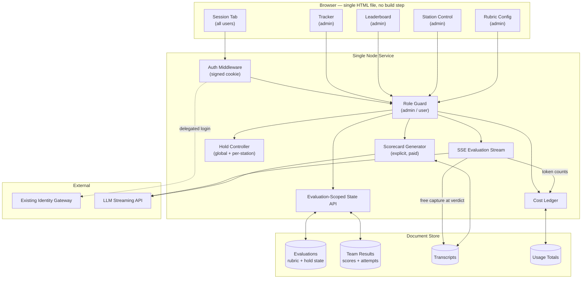

# Real-Time AI Proctoring Architecture — Case Study

## Overview

Designed and built a platform that uses a large language model to evaluate live technical pitches in real time, at a multi-station competitive enablement event, while keeping the scoring decision firmly with a human proctor.

Engineers rotate through a timed circuit of stations. At each one they are given a customer scenario and must pitch a solution against a fixed set of pass criteria. The platform streams the model's assessment token by token so the proctor watches the verdict form and can intervene mid-evaluation; the proctor then records the result on a four-point scale that encodes *how much help was needed*, not merely whether the pitch passed.

The system was later generalised from a single hardcoded event into a multi-evaluation platform: an evaluation is a first-class tenant owning its own stations, rubric, results, transcripts and cost ledger, with every read and write scoped to it and an idempotent migration folding the original event in as the first record.

Built as a single Node service, a zero-build vanilla frontend, and a document store — deliberately small, because the hardest requirement was not scale but **being patchable in sixty seconds at a live venue**.

---

## The Short Version

**The model evaluates. The human scores.** That line was drawn before anything was built,
because the data model, the interface, the streaming requirement and the dispute story all
depend on it.

| The decision | Why |
|---|---|
| The model **never writes a score** — it assesses, the proctor decides | A competitive result a participant can contest must be attributable to a person |
| Scoring is **3 / 2 / 1 / 0**, encoding how much help was needed | Pass/fail makes a team that nailed it and a team that was walked through it look identical |
| Assessment **streams token by token** | A verdict that arrives complete cannot be interrupted, and interruption was the point |
| **No build step** — one hand-written HTML file | The real failure is a bug found twenty minutes before doors open, on conference wifi |
| The attempt is counted **at session start**, not at the verdict | Anything a participant can abandon without cost, they will |
| Raw transcripts captured **free**; the polished scorecard **costs a deliberate action** | Capture is cheap and unrepeatable; refinement is expensive and can always wait |
| Hold is **two independent levers**, global and per-station | One table's laptop dying should not stop the circuit |

What the model is actually for is **consistency of analysis**, not scoring — every proctor
judges against the same criteria applied the same way, rather than a personal reading of a
bullet list at hour four of a long day.

If you read one more section, read [Design Decisions](#design-decisions).

---

## The Problem

A competitive technical enablement event runs dozens of teams through a timed circuit of stations. Each station has a volunteer proctor, a scenario, and a list of things the team must say to pass. The event lasts hours and the results are published on a leaderboard.

This breaks down in four specific ways:

1. **Proctors are not consistent with each other.** Two volunteers at two stations apply the same written criteria differently, and the gap widens as the day goes on and they get tired. A leaderboard built on inconsistent judging is a leaderboard nobody respects.
2. **Pass/fail throws away the coaching signal.** The useful information is not *did they pass* but *did they get there alone, with a nudge, or only after being told*. A binary result makes a team that nailed it and a team that was walked through it look identical.
3. **The event cannot stop.** A station that falls behind, a laptop that dies, a container that restarts — any of these must not take down the circuit or lose the morning's results.
4. **Nobody will learn a tool on the day.** Proctors are volunteers who see the interface for the first time five minutes before the event starts, in a loud room.

The tempting solution — let the model score it — was rejected at the outset and is the subject of the first design decision below.

---

## Architecture

### High-Level Design

> Full diagrams — the evaluation stream lifecycle, the hold state machine, attempt accounting, multi-tenant scoping and the free-capture / paid-refinement split — are in [`/architecture/diagrams.md`](architecture/diagrams.md).

### The Scoring Scale

| Score | Meaning | Points |
|---|---|---|
| 3 | Passed independently — no hints needed | 3 |
| 2 | Passed after hints from the proctor | 2 |
| 1 | Passed only after being given the answer | 1 |
| 0 | Did not pass | 0 |

Five stations, maximum fifteen points. Ties on total score are broken by **fewer attempts**, so a team that got there in one pass outranks a team that got the same score across three.

### Roles

| Capability | Participant | Admin Proctor |
|---|---|---|
| Run an evaluation session | yes | yes |
| Record a result | yes | yes |
| Download own scorecard | yes | yes |
| View tracker grid and leaderboard | no | yes |
| Hold stations, set attempt limits | no | yes |
| Edit the rubric | no | yes |
| Create / switch evaluations | no | yes |
| View cost ledger | no | yes |

Static assets — including the application shell itself — are served behind the auth middleware, so an unauthenticated request never receives the client at all.

---

## Design Decisions

### 1. The Model Evaluates; the Human Scores

**Decision:** The model never writes a score. It assesses the pitch against the criteria in natural language; the proctor records Pass / No Pass and selects the point value.

**Why:** Three reasons, in order of weight. First, a competitive result that a participant can contest has to be attributable to a person. Second, the four-point scale measures how much help the proctor gave — information only the proctor has, because they gave it. Third, the model is evaluating a *summary* of a spoken pitch typed by the proctor, which is already one lossy step from the thing being judged; stacking an automated verdict on that is a confidence the input does not support.

**Trade-off:** Consistency is improved rather than guaranteed — the model standardises the *analysis* every proctor sees, not the decision. That was the correct ceiling to aim for.

### 2. Stream Token by Token, Because the Proctor Needs to Interrupt

**Decision:** Server-sent events, tokens rendered as they arrive, rather than a completed assessment returned in one response.

**Why:** A batch response arrives after the moment to act on it has passed. Streaming turns the evaluation into something the proctor reads *while the team is still standing there* — if the model is heading somewhere wrong, or has misread the typed summary, the proctor sees it forming and corrects the input rather than discarding a finished verdict. The latency perception matters too: in a timed circuit, a four-second blank screen reads as broken.

**Trade-off:** Streaming complicates error handling, because a failure can occur mid-render after partial output. The client treats a truncated stream as an explicit failed state rather than leaving partial text on screen looking like a verdict.

### 3. Zero Build Step — Deliberately

**Decision:** No bundler, no framework, no transpiler. The entire frontend is one hand-written HTML file.

**Why:** This is an event tool. The failure mode that actually matters is a bug discovered twenty minutes before doors open, in a hotel conference centre, on conference wifi. A tool that requires a working toolchain, a successful install and a build to change one line is a tool that cannot be fixed on the day. Editing a file and restarting a process can be done from anything.

**Trade-off:** No component model and no type checking — the file is large and discipline has to substitute for structure. Accepted knowingly: the application has five tabs and one real interaction loop, which is comfortably inside what a single well-organised file can carry. This decision would be wrong for almost any other application.

### 4. The Rubric Is Data, Edited Live

**Decision:** Station name, scenario, customer question, pass criteria, pushback prompts, stumble hints and coaching notes are stored records, editable in the running application with debounced autosave, taking effect on the next session with no restart.

**Why:** Event content changes up to the morning of. A rubric baked into the prompt or the source means a deploy for a typo, and nobody deploys during an event. Keeping the criteria in data also means the same engine runs any evaluation, which is what made the later multi-tenant generalisation a small change rather than a rewrite.

**Trade-off:** A badly edited rubric degrades evaluations immediately and silently. Mitigated by a reset-to-defaults action that restores the vetted content in one click.

### 5. Hold Is Two Independent Levers

**Decision:** A global hold that blocks every new session, and per-station holds that are independent of it and of each other.

**Why:** The failure modes are different. A global pause is for the event — a briefing, an overrun, a problem with the schedule. A single-station hold is for *that station* — the proctor stepped away, the laptop died, the queue is being reorganised. Collapsing them into one control forces an operator to stop the whole circuit to deal with one table.

**Trade-off:** Two pieces of state that can disagree, and an interface that must show which is in effect. Resolution is simply that either one blocks, and the client reports the specific reason.

### 6. The Attempt Is Logged at Session Start, Not at the Verdict

**Decision:** The attempt counter increments when the session opens, before pass or fail is known.

**Why:** Logging at the verdict means an abandoned session costs nothing, so a team that sees the question going badly can simply walk away and come back. With limited attempts as the control on queue length, that loophole eats the schedule. Recording on start also means the counter survives a client crash mid-session, which the verdict-time version did not.

**Trade-off:** A genuine technical failure consumes an attempt. Accepted, because an admin can clear a team's record, and the alternative is unenforceable limits.

### 7. Free Capture, Paid Refinement

**Decision:** The raw transcript is stored automatically at verdict time at no model cost. The polished PDF scorecard requires a deliberate admin action and costs a model call.

**Why:** The expensive artifact is wanted for a minority of sessions, but the raw material is needed for all of them and is worthless if not captured at the moment it exists. Splitting capture from refinement means nothing is lost and nothing is spent speculatively. Generating scorecards for every session of a full event would multiply the model spend for output nobody reads.

**Trade-off:** A two-step workflow for anyone who wants the finished artifact. The regeneration path is explicit rather than implicit, so a rebuild is always an intentional act.

### 8. An Evaluation Is a Tenant, and the Migration Is Idempotent

**Decision:** Generalising from one hardcoded event introduced the evaluation as a top-level entity. Every state route is scoped by evaluation id; two evaluations never see each other's results, transcripts or usage.

**Why:** The second event was going to happen, and the alternative — a second deployment with the content swapped — forks the code and loses the first event's history. Scoping at the route level rather than filtering in handlers means a new endpoint cannot accidentally be written unscoped.

**Trade-off:** An extra selection step. Resolved by auto-selecting when exactly one evaluation is active, which is the common case, so the original single-event experience is unchanged.

The migration runs at boot, folds pre-existing single-config data into the first evaluation record, and only touches documents still missing the scoping field — so it is safe to re-run and safe to deploy to an environment that has already migrated.

### 9. Polling with a Change Fingerprint, Not Websockets

**Decision:** Admin views poll on a fixed interval and re-render only when a fingerprint of the payload changes.

**Why:** A websocket adds a connection state to reason about — reconnection, backoff, missed messages across a container restart — in exchange for freshness that a fifteen-second refresh already provides for a leaderboard. The fingerprint check removes the only real cost of polling, which is a DOM rebuild several times a minute on a projected screen.

**Trade-off:** Up to one interval of staleness. Irrelevant for the data in question, and the cost in robustness is nil.

### 10. Identity Is Delegated; Cost Is Metered

**Decision:** No local password store, no session library — login is proxied to an existing identity gateway and the result is carried in a signed, httpOnly cookie. Separately, token counts and estimated spend accumulate per evaluation, split by call kind.

**Why:** Storing credentials for a short-lived event tool is risk with no upside. And an LLM-backed tool without a cost ledger is one bad loop away from a bill nobody can explain — splitting by call kind is what makes the free-capture / paid-refinement split verifiable rather than merely intended.

**Trade-off:** A hard dependency on the gateway's availability at login time. Sessions are long-lived enough that a gateway blip mid-event does not evict anyone already working.

---

## Technical Patterns

Sanitized design patterns with pseudocode are documented in the [`/patterns/`](patterns/) directory:

| Pattern | Description |
|---|---|
| [Streaming Evaluation](patterns/streaming-evaluation.md) | SSE token streaming, partial-failure handling, and interruption as a feature |
| [Human-in-the-Loop Scoring](patterns/human-in-the-loop-scoring.md) | Model-assesses / human-decides, and the graduated scale |
| [Rubric as Data](patterns/rubric-as-data.md) | Live-editable criteria, prompt assembly, debounced save, reset-to-known-good |
| [Event Operations](patterns/event-operations.md) | Two-lever hold, attempt accounting, restart survival |
| [Multi-Tenant Scoping](patterns/multi-tenant-scoping.md) | Evaluation as tenant, route-level scoping, idempotent migration |
| [Cost Governance](patterns/cost-governance.md) | Free capture vs paid refinement, per-tenant metering by call kind |

---

## Technical Stack

| Layer | Technology |
|---|---|
| **Runtime** | Node.js 18 LTS |
| **Server** | Express — single service, all routes and streaming |
| **AI** | Anthropic Claude (Sonnet class) via the official SDK, SSE streaming |
| **Frontend** | Vanilla HTML / CSS / JavaScript — no framework, no build step |
| **Auth** | Signed httpOnly cookies; identity delegated to an existing API gateway |
| **Persistence** | MongoDB — evaluations, team results, transcripts, usage totals |
| **Documents** | Server-side PDF generation for scorecards |
| **Containerization** | OCI container, Alpine base |
| **Orchestration** | Serverless containers behind an application load balancer |
| **Secrets** | Managed secrets service — no credentials in image or source |
| **CI/CD** | GitHub Actions — push to main builds, publishes and rolls the service |

---

## Impact

- **Consistent analysis across every station** — all proctors evaluate against the same criteria through the same assessment, removing the drift that makes a multi-station leaderboard contestable
- **A coaching signal that survives the event** — the four-point scale distinguishes independent passes from assisted ones, so the results are usable for development afterwards, not just for ranking on the day
- **Zero-restart content changes** — rubric edits take effect on the next session, which removed deployment from the critical path of a live event entirely
- **Event continuity** — results, attempts and hold state persist, so a container restart mid-event costs nothing
- **Independent station control** — a single table can be paused and released without stopping the circuit
- **Generalised to a multi-evaluation platform** without forking the deployment, preserving the original event's history as the first tenant
- **Metered model spend** per evaluation and per call kind, with the expensive artifact behind a deliberate action rather than generated speculatively for every session

---

## Stated Limitations

**The model judges a typed summary, not the pitch.** The proctor transcribes or paraphrases what the team said. Everything downstream inherits the fidelity of that step, which is the strongest argument for keeping the scoring decision human and the reason no attempt was made to automate the verdict.

**Rubric quality is unguarded.** A badly written criterion produces a confidently wrong assessment, and nothing in the system detects it. Reset-to-defaults limits the blast radius of a bad edit; it does not validate a new one.

**Single-writer assumptions on the rubric.** Two admins editing the same evaluation's configuration concurrently will overwrite one another. Acceptable for the operating model — one event owner — and stated rather than discovered.

**Cost figures are estimates.** The ledger accumulates token counts and applies published rates. It is accurate enough to govern behaviour and is not an invoice.

**Attempt limits are per team per station, enforced server-side**, but a team operating under two different names is two teams as far as the system is concerned. Name collisions and name drift are handled by admin correction, not prevented.

---

## Lessons Learned

### 1. Decide Where the Model's Authority Ends Before You Build Anything
The scoring question — does the model decide, or does the human — determined the data model, the interface, the streaming requirement and the dispute story. It is not a detail to settle later, because every one of those is hard to reverse. Framing the model as *the thing that makes every proctor's analysis consistent* rather than *the thing that scores* produced a system people trusted enough to actually use competitively.

### 2. Streaming Is an Interaction Decision, Not a Performance One
The case for SSE here had almost nothing to do with speed. It was that a verdict arriving complete is a verdict that cannot be interrupted, and interruption was the whole point — the proctor is a participant in the evaluation, not a recipient of it. Choosing streaming for the interaction reason led to a different interface than choosing it for latency would have.

### 3. Optimise for the Failure You Will Actually Have
The realistic failure was never load. It was a bug found twenty minutes before doors open in a room with bad wifi. Every architectural choice that looks under-engineered — one file, no build, polling, a single service — is that constraint applied honestly. The discipline is naming the real failure mode first, because it rarely matches the one the default architecture defends against.

### 4. Count the Attempt When It Starts, Not When It Ends
Recording an outcome at the point of outcome seems obviously right and quietly creates an opt-out: anything a participant can abandon without cost, they will. The general lesson is that a counter used as a control has to increment at the point of *commitment*, not the point of *result* — and the two are rarely the same moment.

### 5. Separate Capturing From Refining
Capturing raw material is cheap and irreversible if skipped; refining it is expensive and can always be done later. Splitting those two into a free automatic step and a deliberate paid one gave complete coverage with minimal spend, and it generalises well beyond this system — any pipeline with an expensive enrichment stage should ask whether the enrichment needs to happen at capture time. Almost never.

### 6. Generalise on the Second Instance, Not the First
Multi-tenancy was built when the second event became real, not speculatively at the start. By then the shape of what varied between events was known from evidence rather than guessed, which is why the change was a scoping pass and a boot migration rather than a rewrite. The cost of deferring was one migration; the cost of guessing early would have been the wrong abstraction baked into everything.
