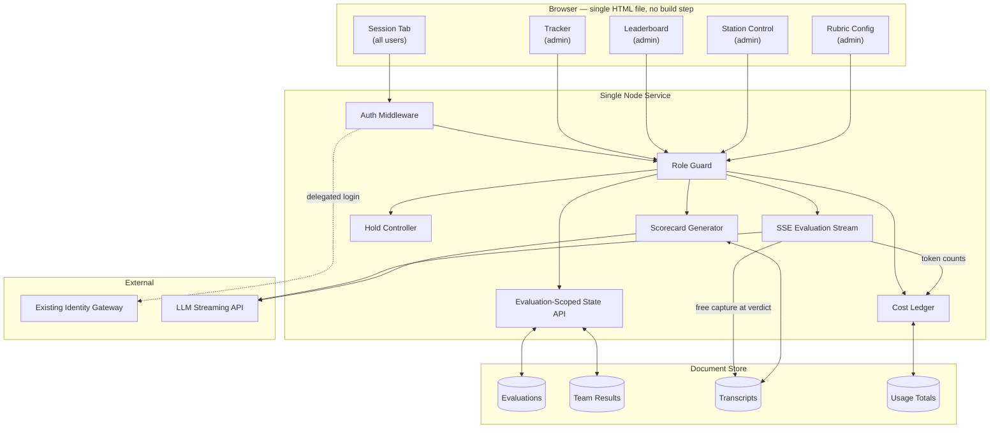
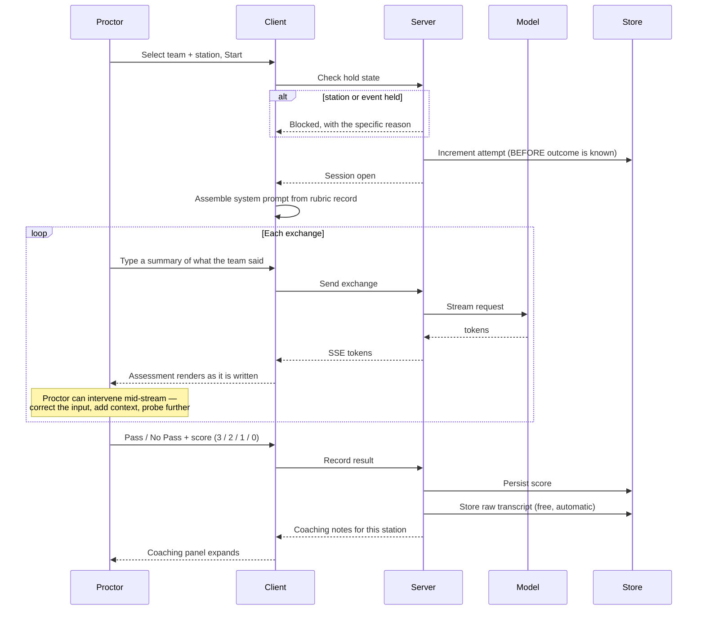
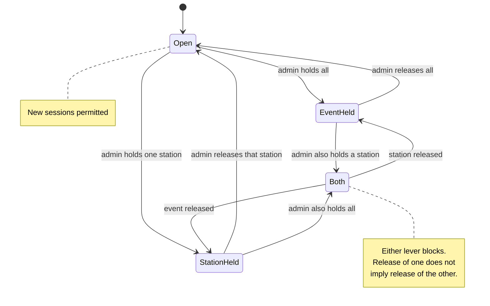
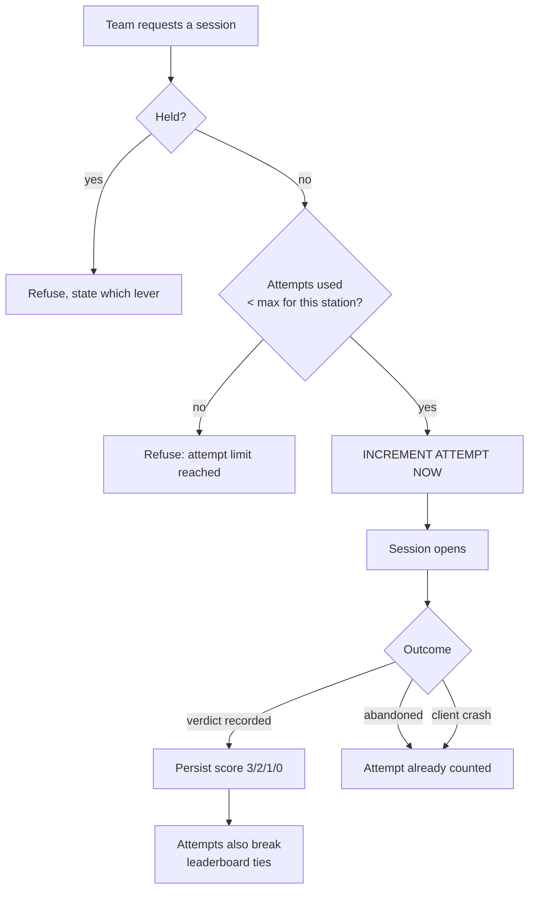
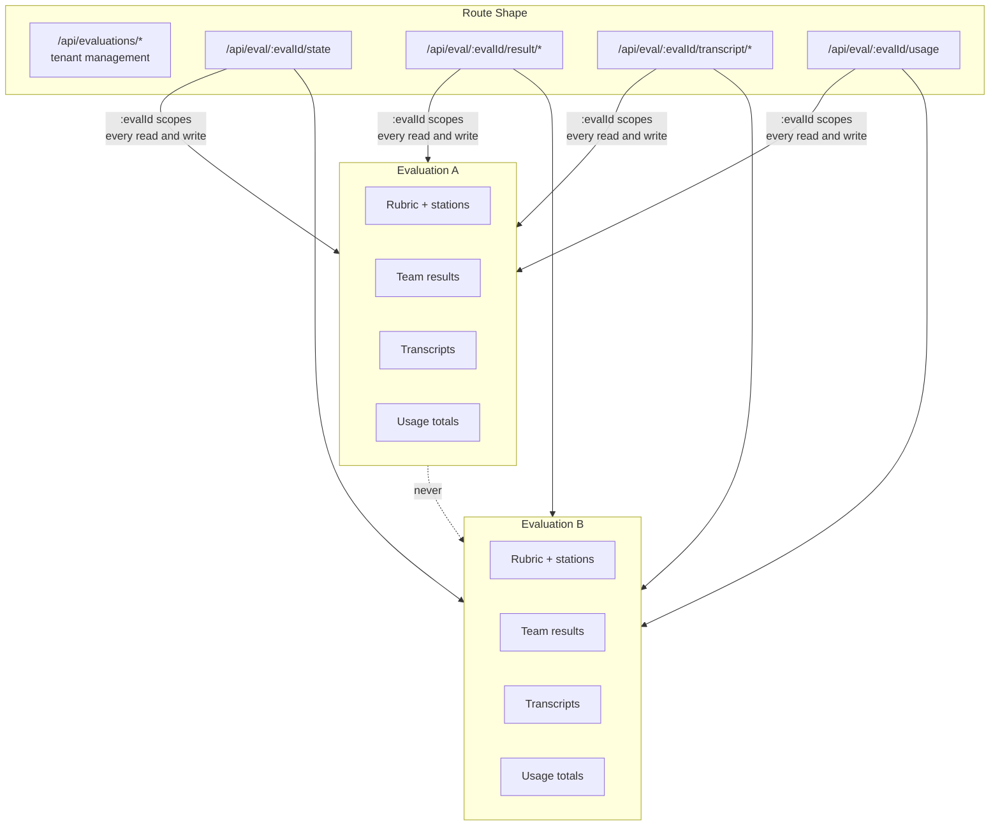
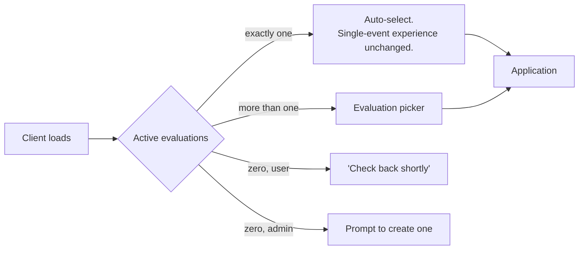
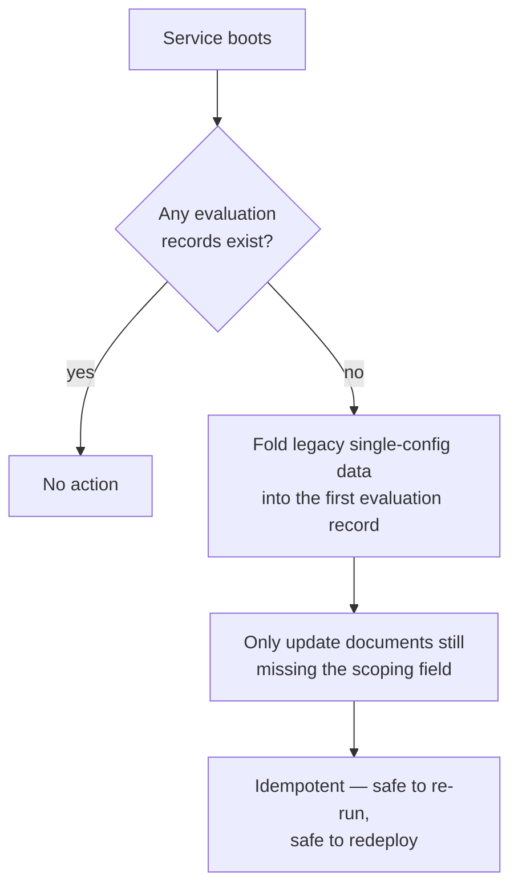
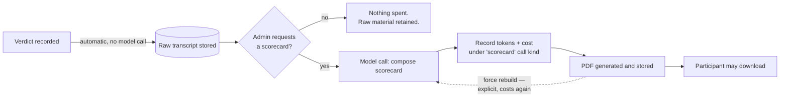
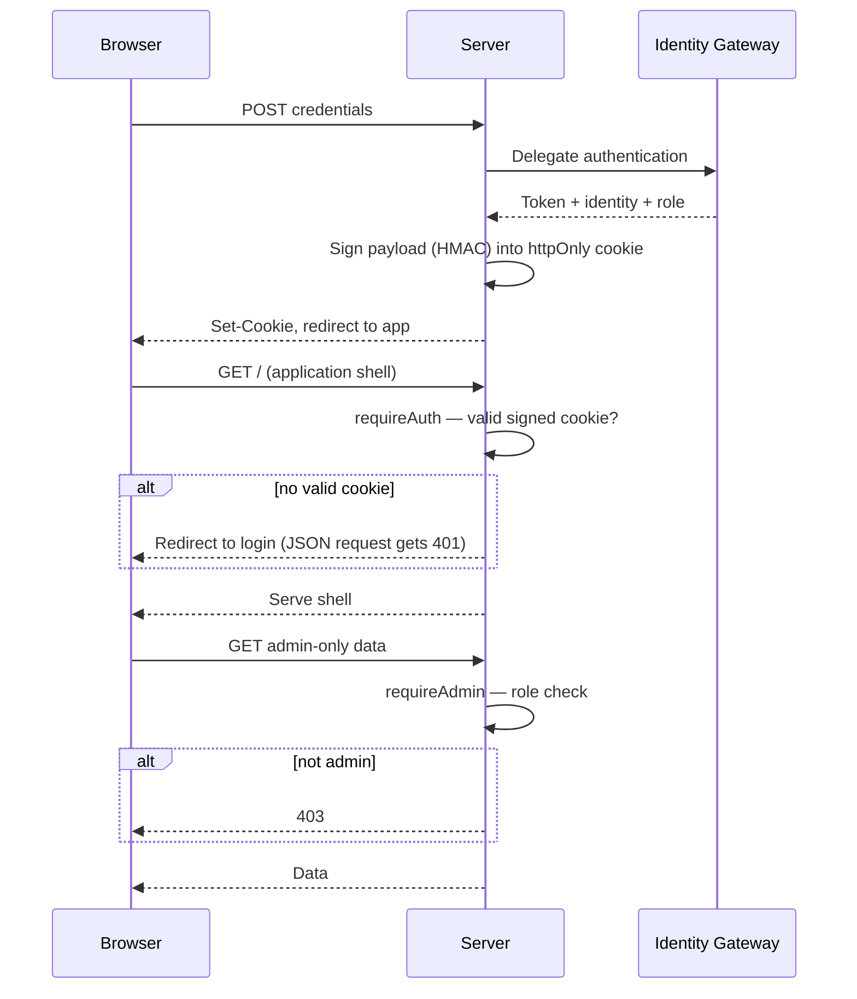

# Architecture Diagrams

Detailed diagrams for the real-time AI proctoring platform. All diagrams
describe design and control flow; none describe implementation internals.

---

## 1. High-Level System Architecture

---

## 2. Evaluation Session Lifecycle

The human is in the loop at two points: composing what the model sees, and
deciding the outcome. The model never writes a score.

---

## 3. The Two-Lever Hold

Global hold and per-station hold are independent. Either blocks; the client is
told which.

**Why two levers.** A global pause is an event-level action — a briefing, a
schedule overrun. A station hold is a table-level action — the proctor stepped
away, the laptop died, the queue is being reorganised. One control would force
an operator to stop the entire circuit to deal with one table.

---

## 4. Attempt Accounting

> Incrementing at **commitment** rather than at **result** closes the walk-away
> loophole and survives a client crash. The cost — a genuine technical failure
> consumes an attempt — is absorbed by an admin clear.

---

## 5. Multi-Tenant Scoping

Scoping in the **route** rather than in handler logic means a newly added
endpoint cannot accidentally be written unscoped — the id is not available
except through the scoped path.

### Selection behaviour

### Migration

---

## 6. Free Capture, Paid Refinement

The expensive artifact is wanted for a minority of sessions; the raw material is
needed for all of them and is unrecoverable if not captured when it exists.
Metering by call kind is what makes the split verifiable rather than merely
intended.

---

## 7. Authentication and Role Resolution

No local password store and no session library. Static assets — including the
application shell — are served **behind** the auth middleware, so an
unauthenticated request never receives the client at all.
