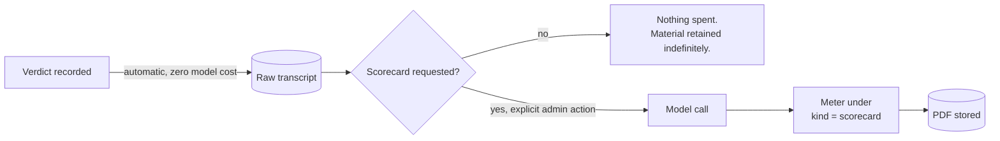

# Cost Governance Pattern

An LLM-backed tool without a cost ledger is one bad loop away from a bill nobody
can explain. Two mechanisms: meter everything, and make the expensive thing
deliberate.

---

## Free Capture, Paid Refinement



The asymmetry that drives this:

| | Raw transcript | Polished scorecard |
|---|---|---|
| Needed for | every session | a minority of sessions |
| Cost to produce | none | a model call |
| Recoverable later? | **no** — gone if not captured | yes, any time |

Capture is cheap and irreversible if skipped. Refinement is expensive and can
always be done later. So capture everything automatically and refine on request.

Generating a scorecard for every session of a full event would multiply model
spend for output most people never open.

### Regeneration is explicit

A rebuild of an existing scorecard requires an explicit force flag. There is no
path where a page refresh or a retry quietly spends again.

---

## Metering by Call Kind

```
meter(evaluationId, kind, tokensIn, tokensOut):
    accumulate(usageKey(evaluationId), {
        [kind + ".in"]:    tokensIn,
        [kind + ".out"]:   tokensOut,
        [kind + ".calls"]: 1,
        [kind + ".cost"]:  estimate(tokensIn, tokensOut),
    })
```

Splitting by kind — evaluation streaming versus scorecard generation — is what
makes the free-capture / paid-refinement split **verifiable** rather than merely
intended. A single blended total would hide a regression where scorecards start
generating automatically.

Metering happens in the `finally` branch of every model call. A failed call
still consumed tokens, and a ledger that only records successes understates
spend exactly when something is going wrong.

---

## Per-Tenant, and Resettable

Usage is scoped to the evaluation like everything else, so the cost of each
event is separable. An admin can zero the counter — useful when the same
evaluation is reused for a rehearsal and then the real thing.

| Operation | Access |
|---|---|
| View cumulative cost for an evaluation | Admin |
| Reset the counter | Admin |
| Any visibility at all | Not exposed to participants |

---

## Stated Honestly: These Are Estimates

The ledger accumulates token counts and applies published rates. It is accurate
enough to govern behaviour — to notice that scorecard generation is running away,
or that an event cost four times what the last one did — and it is **not an
invoice**.

Presenting an estimate as a reconciled figure would be the same error the
provenance work in a sibling project exists to prevent: a number that looks
authoritative carrying less evidence than its presentation implies.

---

## What Transfers

1. **Separate capture from enrichment.** Any pipeline with an expensive
   enrichment stage should ask whether enrichment must happen at capture time.
   Almost never. Capture is the step that cannot be redone.
2. **Meter in `finally`, not on success.** Failure costs money too.
3. **Split the meter by the thing you are trying to control.** A blended total
   cannot tell you that the policy you designed has stopped holding.
4. **Make the expensive path an act, not a side effect.** Nothing that spends
   money should be reachable by a refresh.
