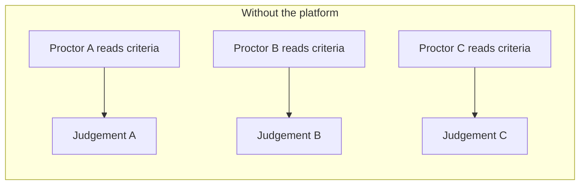
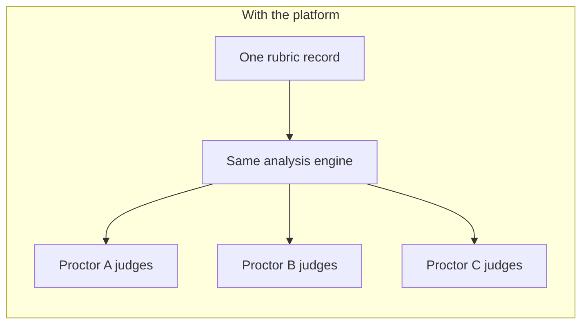

# Human-in-the-Loop Scoring Pattern

The model assesses. The human decides. This boundary was fixed before anything
was built, because every downstream decision depends on it.

---

## The Division

| Responsibility | Owner |
|---|---|
| Interpret the pass criteria | Model |
| Assess the pitch against them, in writing | Model |
| Probe, push back, surface what is missing | Model |
| Judge whether the team passed | **Proctor** |
| Judge how much help they needed | **Proctor** |
| Record the result | **Proctor** |

The model's output is never parsed for a verdict. There is no "extract the
score from the response" step, because no such step would be trusted.

---

## Why the Model Does Not Score

Three reasons, in order of weight.

### 1. A competitive result must be attributable to a person

The output feeds a leaderboard. A participant who disputes a result is entitled
to an answer, and *"the model decided"* is not one. A named proctor who made a
judgement is.

### 2. The scale measures something only the proctor knows

| Score | Meaning |
|---|---|
| 3 | Passed independently |
| 2 | Passed after hints |
| 1 | Passed only after being given the answer |
| 0 | Did not pass |

Scores 3, 2 and 1 are all passes. What separates them is **how much help the
proctor gave** — information the proctor has because they gave it, and which is
not reliably recoverable from the transcript.

### 3. The input is already lossy

The model is reading a typed summary of a spoken pitch, composed under time
pressure. That is one lossy step away from the thing being judged. Stacking an
automated verdict on top asserts a confidence the input does not support.

---

## What the Model Is Actually For

Not scoring — **consistency of analysis**.





Every proctor sees the same criteria applied the same way. The judgement stays
human, but it is now a judgement made on a common analysis rather than on a
personal reading of a bullet list at hour four of a long day.

**This is a ceiling, not a guarantee.** Consistency is improved, not enforced.
Aiming at the right ceiling was the design decision.

---

## Recording

```
recordResult(evaluationId, team, stationIndex, passed, score):
    require(score in [0,1,2,3])
    require(passed == (score > 0))        # the two cannot disagree
    persist({ evaluationId, team, stationIndex, passed, score,
              proctor: session.identity, at: now() })
    storeTranscript(evaluationId, team, stationIndex, messages)  # free
    return coachingNotesFor(stationIndex)
```

Two deliberate details:

- **`passed` and `score` are checked against each other** rather than one being
  derived from the other, so an interface bug that lets them diverge fails loudly
  at the boundary.
- **Coaching notes are returned on recording, not before.** They are the
  station's prepared guidance, and releasing them earlier would let a proctor
  read the answer to the team during the evaluation.

---

## Tie-Breaking Encodes the Same Value

Leaderboard ties on total score are broken by **fewer attempts ascending**. A
team that reached a score in one pass outranks a team that reached the same
score in three. Both the scale and the tie-break reward getting there with less
help — the ranking agrees with what the event is trying to develop.
